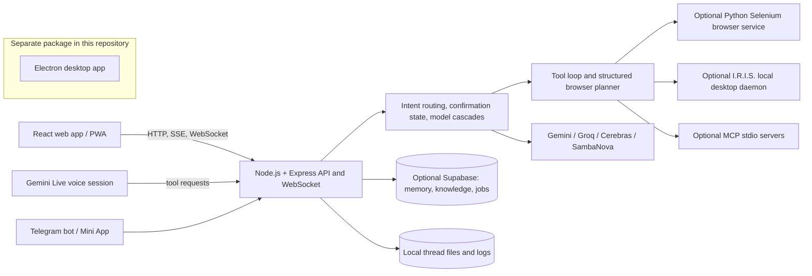

# J.A.R.V.I.S. — Agentic Assistant Workspace

<p align="center">
  
</p>

**J.A.R.V.I.S.** (Just A Rather Very Intelligent System) is a personal AI system for conversation, research, memory, scheduled work, and controlled actions across web and desktop environments. Voice is one way to interact with it; the core project is a multi-surface application with model routing, intent orchestration, tool execution, integrations, persistence, and operational telemetry.

<p align="center">
  
</p>

This repository contains several related runtimes. The web application and Node.js service are the primary entry point. The Python browser service, I.R.I.S. desktop bridge, voice biometrics service, and Electron desktop client are separate components that require their own configuration and should not be assumed to be running just because the web UI is available.

## What the system does

- **Routes requests by intent.** The backend distinguishes ordinary conversation, actionable tasks, scheduling requests, and confirmation replies. Each route has a different execution path.
- **Uses model cascades.** Chat, structured planning, web research, and Gemini Live voice have separate provider/model priorities and fallbacks. The selected provider and model are reported in chat metadata and logs.
- **Runs bounded agent workflows.** Chat can use a multi-step tool loop. Browser tasks use a structured planner, a confirmation gate for selected actions, and an executor. Tool results are returned to the conversation so the assistant can respond with execution outcomes.
- **Connects tools and services.** The backend includes semantic knowledge retrieval, Google Search-grounded research, background research delivery, reminders and recurring jobs, Telegram messaging, and optional MCP tools.
- **Supports multiple interfaces.** The React web app provides chat, live voice, task and job views, a browser-agent panel, and MCP settings. Telegram provides remote text and voice entry points. A separate Electron application lives in [`jarvis-desktop`](jarvis-desktop/README.md).
- **Can delegate local actions.** When configured, browser tasks can use the Python Selenium service, and local computer actions can be sent to the I.R.I.S. desktop daemon. Both require those components to be running and reachable.
- **Tracks operations.** Structured logs and token/latency metrics are written by the Node service; the UI and log portal expose parts of this operational state.

## Architecture at a glance



The diagram shows integration points, not a promise that every optional service is deployed. See [Architecture](project_docs/ARCHITECTURE.md) for runtime paths and boundaries.

## Voice model priority

The web voice client currently tries `gemini-3.8-live-extended-thinking` first, followed by the existing Gemini Live fallback models. This priority applies to the **Live voice session** only. Text chat, planning, and research use their own provider cascades in `server/llmRouter.ts`.

## Repository layout

| Path | Responsibility |
|---|---|
| `src/` | React web interface, chat and voice clients, task panels, and API client |
| `server.ts` | Web server entry point; starts Express, Vite, WebSockets, Telegram, scheduler, and MCP initialization |
| `server/` | API routes, model routing, intent orchestration, tools, memory, scheduler, browser planning, MCP, and logging |
| `python_agent/` | Optional FastAPI/Selenium browser service, including visual page marking and execution endpoints |
| `voice_engine_microservice/` | Optional SpeechBrain speaker matching service |
| `jarvis-desktop/` | Separate Electron application with its own renderer, main/preload code, and server modules |
| `project_docs/` | Current architecture, status, setup, development, and roadmap documentation |
| `data/`, `logs/`, `uploads/` | Runtime data; ignored by Git and created or populated at runtime |

## Run the web application locally

Requirements: Node.js and npm. Integrations beyond the base app need their own credentials and services.

```bash
git clone https://github.com/Susant07-star/Jarvis-AI.git
cd Jarvis-AI
npm ci
```

Create a local environment file from the template, then replace every placeholder and sample credential with your own values:

```powershell
Copy-Item .env.example .env.local
```

For the current web chat route, configure valid `GEMINI_API_KEY` and `GROQ_API_KEY` values; the route checks for both. Set a unique, private `JARVIS_PIN` before starting the server; startup stops if it is missing. Optional variables for Telegram, Supabase, search, I.R.I.S., browser execution, and voice biometrics are documented in [`.env.example`](.env.example) and [the developer guide](project_docs/DEVELOPER_GUIDE.md).

Start the combined Express/Vite development server:

```bash
npm run dev
```

By default, the server listens on port `3000`. Open `http://localhost:3000`.

Useful root scripts:

```bash
npm run build   # Build the web client
npm run lint    # TypeScript check (tsc --noEmit)
```

The root package does not currently declare a general `test` script. The Python and Electron subprojects have separate setup and verification needs.

## Optional components

### Python browser service

Browser execution through the Selenium service is opt-in. Set `USE_BROWSER_AGENT=true`, install `python_agent/requirements.txt`, and run `python python_agent/youtube_agent.py` from the repository root. The service listens on port `8000`; the Node backend calls it on `127.0.0.1`. Keep this service on a trusted local network: its HTTP endpoints do not implement the Node app's PIN check.

### Supabase-backed memory and scheduling

The web server uses Supabase when configured for semantic thread memory, knowledge retrieval, and persisted task/job records. The database needs the expected tables and vector-search RPC functions; see [Architecture](project_docs/ARCHITECTURE.md). Local thread-file storage is also used as a fallback, but it is not a substitute for a verified database setup.

### Telegram, I.R.I.S., and voice biometrics

These integrations are optional and require credentials, network endpoints, and the corresponding bot, local desktop daemon, or Python service to be running. Their presence in the repository does not mean a deployed instance is connected. Configuration notes are in the [Developer Guide](project_docs/DEVELOPER_GUIDE.md).

### Electron desktop app

`jarvis-desktop/` is a separate Electron/Vite project with its own dependencies and build scripts. It is not the same runtime as the web app and is not automatically packaged by the root build. Follow [`jarvis-desktop/README.md`](jarvis-desktop/README.md).

## Security and scope

This is an actively developed personal system, not a security-audited multi-user product. The web server binds to `0.0.0.0`; the configured `JARVIS_PIN` protects API and WebSocket access, and the log portal uses its own credential rules. `/api/config/auth` is PIN-protected and returns the Supabase URL, browser anon key, and owner allowlist; it never returns the server-side `SUPABASE_KEY`. The Google owner allowlist is checked in the React client only; backend API authorization is the shared PIN, so Google login is not a server-side API access control. Gemini Live connects directly from the browser, so `/api/config/keys` supplies the Gemini key to that browser; anyone with access to the PIN and an active session can inspect it. The Python browser service is separate and does not inherit the Node API PIN middleware. Replace all example values, keep the app and local automation services private, and review the action path before enabling them on a network-facing deployment.

Voice matching is an optional convenience layer, not a reliable identity or anti-spoofing guarantee. Its current liveness check is a basic audio heuristic. Do not use voice matching as the sole access-control mechanism.

## Documentation

- [Documentation index](project_docs/README.md)
- [System architecture](project_docs/ARCHITECTURE.md)
- [Repository status and limitations](project_docs/SYSTEM_STATUS.md)
- [Developer setup and code map](project_docs/DEVELOPER_GUIDE.md)
- [Development rules](project_docs/PROJECT_INSTRUCTIONS.md)
- [Debugging guide](project_docs/DEBUGGING.md)
- [Roadmap](project_docs/ROADMAP.md)
- [Changelog](project_docs/CHANGELOG.md)

## License

MIT. See [LICENSE](LICENSE).
