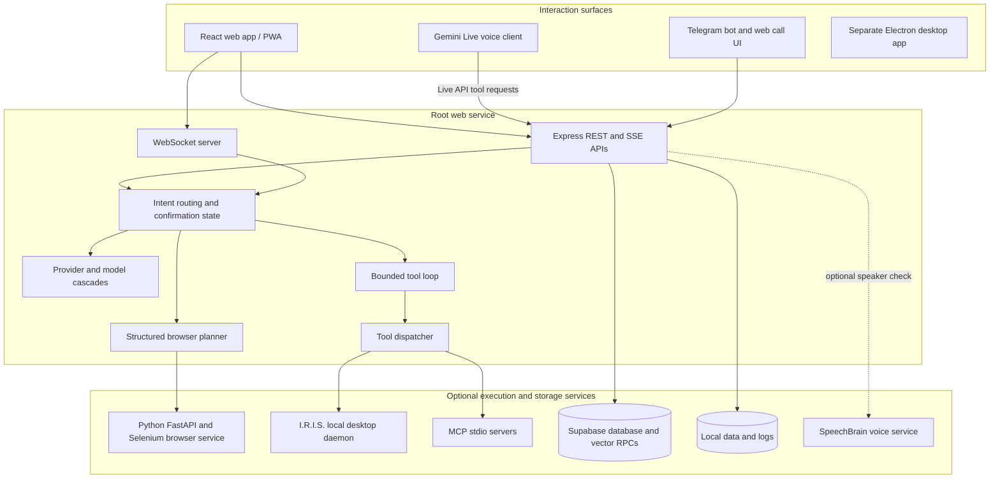

# J.A.R.V.I.S. System Architecture

> Repository-grounded architecture overview. This describes code paths present in the repository; it does not assert that optional services are deployed or currently reachable. See [System Status](SYSTEM_STATUS.md) for configuration and operational limits.

## System overview

J.A.R.V.I.S. is a multi-surface assistant and agent workspace. It has separate request paths for chat, live voice, research, scheduling, browser work, and local desktop actions. Routing is implemented in TypeScript; the repository does not currently use LangGraph as its orchestration runtime.

The Electron client is a separate package under `jarvis-desktop/`; it has its own Electron main/preload/renderer code and server modules. It is not the root web service packaged inside Electron. The Python, I.R.I.S., MCP, Supabase, and voice services are optional integration points.

## Runtime components

### Web client and Node service

- `src/` contains the React interface, chat client, Gemini Live voice client, and API calls.
- `server.ts` starts Express, mounts `server/routes/api.ts`, adds Vite middleware in development or serves `dist/` in production, and attaches a WebSocket server.
- Startup also initializes the Telegram bot, one-time scheduler, recurring job manager, optional voice-engine heartbeat, and MCP manager.
- `server/routes/api.ts` is the HTTP entry point for chat, research, knowledge, scheduling, memory, MCP, system status, and I.R.I.S. actions.
- The Express service listens on port `3000` by default and binds to `0.0.0.0`.

### Request routing and model selection

There is no single model cascade for every task:

| Request type | Current implementation |
|---|---|
| Live voice | `src/services/zoyaLiveService.ts` opens a Gemini Live session. `gemini-3.8-live-extended-thinking` is first in the configured order, followed by the retained Gemini Live fallback models. The first model receives high thinking configuration and non-blocking tool declarations. |
| Chat | `server/llmRouter.ts` uses its chat provider list, currently starting with Gemini 3.1 Flash Lite and then configured Groq, Cerebras, SambaNova, and Gemini fallbacks. Image-bearing chat uses a separate Gemini-only list. |
| Structured browser planning | `callPlannerWithCascade()` sends JSON-constrained requests through a smaller planner provider list. The planner parses actions and a confirmation flag. |
| Research | `callResearchWithCascade()` uses Gemini models with Google Search grounding. |
| Intent classification | `server/intentClassifier.ts` selects direct conversation, task, or schedule handling before the main execution route. |

Provider availability depends on environment variables and provider-side model access. A configured priority is not proof that a model call or fallback has been successfully exercised in a deployment.

### Agent and tool execution

The web chat path uses `determineOrchestrationMode()` in `server/orchestrator.ts`. Confirmation replies are checked before a new intent classification. Direct conversational requests can enter `runAutonomousLoop()` in `server/agenticLoop.ts`, which calls the chat cascade and dispatches parsed tools through `server/toolDispatcher.ts` with a maximum of seven iterations by default. Scheduling intents have a dedicated parser and scheduler path.

Actionable browser requests use `server/browser/planner.ts` to form structured actions. The `/api/chat` and `/api/zoya-execute` paths can request a marked screenshot from the Python service when `USE_BROWSER_AGENT=true`; execution of browser actions then requires that service on `127.0.0.1:8000`. Some actions are routed to the Node scheduler/search path or to I.R.I.S. The repository also contains Playwright browser modules under `server/browser/`; treat them as a separate/legacy execution path until a call site confirms they are used by the route being changed.

Tool calls are proposals produced by a model; the TypeScript backend parses and executes them. The planner asks for confirmation for selected sensitive actions, but this is not a universal approval gate for every tool or every surface. Review the relevant route before adding an action.

### Optional local and external services

- **Python browser service:** `python_agent/youtube_agent.py` exposes FastAPI endpoints on port `8000` and uses Selenium/Chrome. It is optional and controlled by `USE_BROWSER_AGENT` in the root Node service. The service currently binds `0.0.0.0` and does not apply the Node API PIN; keep it behind a trusted local boundary.
- **I.R.I.S. desktop bridge:** `server/irisExecutor.ts` sends commands to `IRIS_WORMHOLE_URL` with an `IRIS_API_KEY` bearer token. The daemon must run on the user's machine and be reachable. Local control is not available merely because the cloud/web app is online.
- **MCP:** `server/mcpManager.ts` loads `data/mcp_config.json`, starts configured child processes over stdio, discovers their tools, and dispatches namespaced calls. A configured MCP server has the permissions of its process.
- **Voice matching:** `voice_engine_microservice/` is a separate FastAPI service using SpeechBrain ECAPA embeddings. It is optional. Its current audio liveness check is a simple heuristic and must not be treated as secure authentication.
- **Electron desktop:** `jarvis-desktop/` is independently installed and launched with Electron Vite. It contains local desktop features and a separate copy of backend/server modules; integration and behavior are specific to that package.

### Memory, knowledge, and scheduling

- `ThreadManager` stores conversation history in Supabase `memory_store` when configured and also maintains rolling JSON files under `data/threads/` as local fallback/backup. Embeddings use Gemini's `gemini-embedding-001` model. Semantic history search requires the Supabase `match_memories` RPC.
- `KnowledgeManager` stores notes and documents in Supabase `knowledge_base` and queries the `match_knowledge` RPC. This is separate from short-term thread history and requires its table, embedding column, and function to be provisioned.
- One-time tasks are represented in the in-process scheduler and may be recorded in Supabase. Startup initialization can restore persisted tasks, but delivery still depends on a running Node process and working downstream channels.
- Recurring routines are read from Supabase `research_jobs` and scheduled in-process with `node-cron`. There is no external queue service in the current runtime, so downtime and timezone/configuration behavior need operational testing.

### Prompt assembly and observability

- `server/agent_prompts/agents/` selects prompt modules from `server/agent_prompts/modules/`; `prompt_builder.ts` assembles the requested prompt. It is a modular prompt loader, not a separate agent runtime.
- `server/logger.ts` captures service logs; token and latency metrics are recorded by `server/utils/metrics.ts`. The project also includes a log portal and feedback logging.
- The UI can display selected model/provider metadata, task state, memory statistics, and voice state. Telemetry availability depends on the request path and configured services.

## Configuration boundaries

The root app reads environment variables from `.env` and `.env.local`. `GEMINI_API_KEY` is required for the primary model-backed paths; `GROQ_API_KEY` is also checked by the chat route and supports classification/transcription-related paths. Supabase, Telegram, search, Python browser, I.R.I.S., and voice service variables enable optional integrations. See [`.env.example`](../.env.example) and [Developer Guide](DEVELOPER_GUIDE.md).

`JARVIS_PIN` is required at server startup. The PIN middleware protects API routes, including `/api/config/auth` and `/api/config/keys`; log routes enforce their own credential check. `/api/config/auth` returns `SUPABASE_URL`, the browser-safe `SUPABASE_ANON_KEY`, and the owner allowlist, never the server-side `SUPABASE_KEY`. The owner allowlist is checked in the React client only; backend API authorization is the shared PIN, so Supabase sign-in is not a server-side API access control. Gemini Live currently connects from the browser, so the authenticated client receives the Gemini key from `/api/config/keys`; anyone with the PIN and an active browser session can inspect it. The Python browser service is separate and does not inherit this middleware.

## Known architectural limits

- Similar capabilities exist in multiple places: web Live voice, Telegram voice, Electron voice, Python Selenium, Playwright modules, and I.R.I.S. They do not all share one executor or state store.
- Browser, voice-biometrics, Supabase, MCP, Telegram, and I.R.I.S. behavior is conditional on runtime configuration.
- Conversation memory, scheduler records, and recurring jobs span local files, in-process timers, and Supabase; this is not a single transactional persistence layer.
- Confirmation rules are route- and tool-specific. Review actions with external effects before expanding automation.
- No LangGraph dependency or graph runtime is present in the root package. The current control flow is explicit TypeScript code; consider a graph framework only if durable stateful workflows become a requirement.
